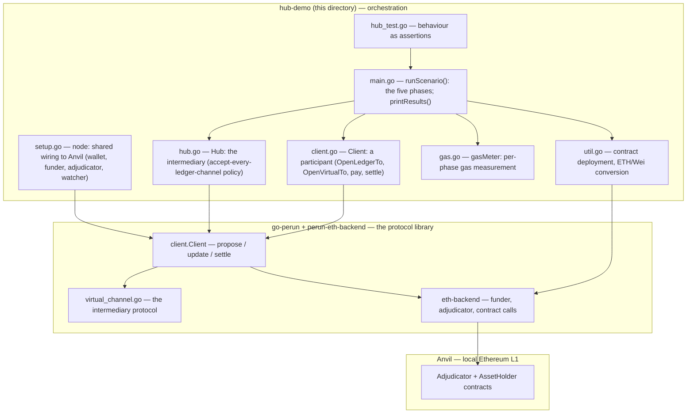
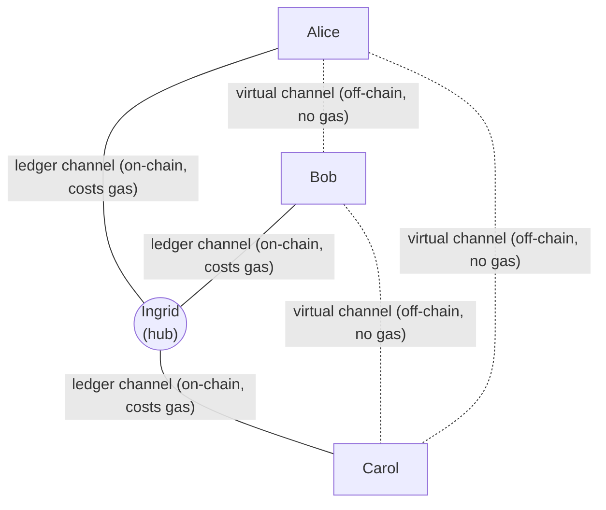
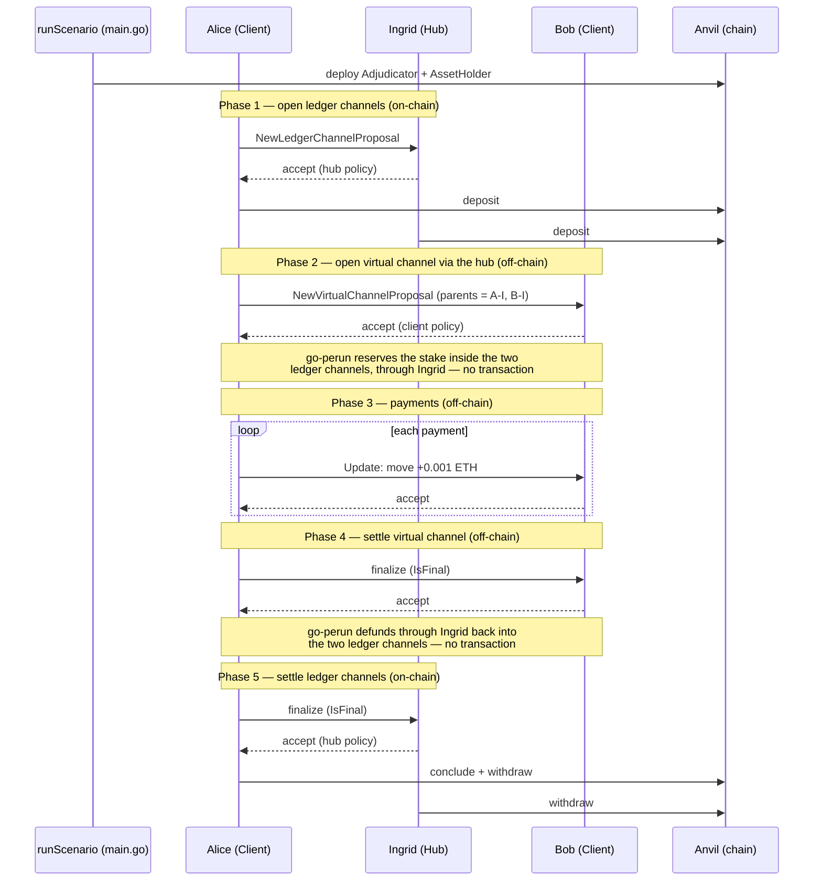

# hub-demo — architecture and code guide

> **Scope note (2026-10-12):** this guide describes the **local in-process demo**
> (`-mode local`, all nodes on one `wire.LocalBus`), built before the Pi cluster
> work. The UC1 and UC2 modes that the thesis measurements use (`uc1-*`, `uc2-*`)
> are documented in [`DISTRIBUTED.md`](DISTRIBUTED.md); the mode → file map is in
> [`README.md`](README.md).

## Scope

This document describes the structure of `hub-demo` and how to read its source. The
implementation is small by design: it is orchestration only. The state-channel
protocol is provided by the `go-perun` library. The code in this directory opens
channels, sends payments, and settles by calling go-perun, which performs the
cryptography, peer-to-peer messaging, on-chain funding, and dispute handling. The
control flow worth reading is therefore the sequence of library calls, not a
reimplementation of the protocol.

## Explanation in 60 seconds

State channels move payments off-chain. Two parties lock funds once on-chain in a
*ledger channel*, then exchange signed balance updates at no marginal cost. To allow
many parties to transact without a dedicated channel for every pair, we use a *hub*:
each participant opens one ledger channel to the hub, and any two participants then
open a *virtual channel* through the hub, entirely off-chain. This demo configures
one hub and N clients against a local Ethereum node (Anvil), opens the ledger
channels, opens a full mesh of virtual channels, runs a burst of payments, and
settles, recording on-chain gas and off-chain throughput. It demonstrates that
on-chain cost grows linearly with the number of participants, while the virtual
channels that carry the payments cost no gas.

## Code boundary

The table separates what this directory implements from what go-perun provides.

| Implemented here (orchestration) | Provided by go-perun |
|---|---|
| The topology: one hub, N clients | The channel state machine and signatures |
| Each node's accept policy (handlers) | Routing channel messages between peers |
| The calls to open, pay, and settle | Funding a virtual channel through the hub |
| Gas and throughput measurement | Watching the chain for disputes; on-chain settlement |

The intermediary logic resides in go-perun (`client/virtual_channel.go`). See
`hub.go` for the hub node, which is an ordinary go-perun client configured to accept
every ledger channel (in this local demo; the distributed and UC2 hub add the
admission, deposit and payment policies described under *Reading order*).

## Diagram 1 — components



ASCII equivalent:
```
hub-demo (this directory)        go-perun (library)            Anvil (chain)
  main.go  ──────────────┐
  setup.go ─ wiring ─────┼────►  client.Client ──► virtual_channel.go
  hub.go   ─ policy ─────┤              │
  client.go ─ open/pay ──┘              └────────►  eth-backend ──► Adjudicator + AssetHolder
  gas.go / util.go (helpers)
```

## Diagram 2 — topology



- Solid lines are ledger channels (a star): N of them, each costing roughly 91k gas. This is the only on-chain cost.
- Dotted lines are virtual channels (a mesh): C(N,2) of them, opened and closed off-chain at no gas, carrying the payments.

N ledger channels (linear, on-chain) enable C(N,2) virtual channels (quadratic,
off-chain, no gas). This relationship is the property the demo measures.

## Diagram 3 — lifecycle

The phases below correspond one-to-one to the blocks in `runScenario`.



## Reading order

The source is best read in the order of the control flow.

1. `main.go`, function `runScenario` — the five phases. Each phase is a small block
   with a comment; reading it top to bottom covers the whole program.
2. `client.go` — the participant operations: `OpenLedgerTo`, `OpenVirtualTo`, `pay`,
   `finalize`, `settle`. The go-perun calls that perform the work are here.
3. `hub.go` — the intermediary. In the local demo it accepts every ledger channel
   and every update. For the distributed and UC2 hub it also has optional policies:
   admission (`RequireRegisteredPeers`: only registered peers), deposit
   (`RequireLedgerDeposits`: exact `[player, hub]` balances) and payment
   (`RequireSafePaymentUpdates`: a player may only pay the hub).
4. `setup.go` — how a go-perun client is wired to Anvil. This is configuration that
   rarely changes.
5. `gas.go` and `util.go` — gas measurement, contract deployment, and unit helpers.
6. `hub_test.go` — the expected behaviour expressed as assertions.

## Glossary

- **Ledger channel** — a channel funded by an on-chain deposit from both parties.
  Opening and closing it cost gas. (Solid lines in Diagram 2.)
- **Virtual channel** — a channel funded off-chain out of two ledger channels that
  share a common intermediary. It costs no gas. (Dotted lines in Diagram 2.)
- **Intermediary / hub** — the party (Ingrid) that both endpoints share a ledger
  channel with, so a virtual channel can be routed through it.
- **Adjudicator** — the on-chain contract that arbitrates disputes.
- **AssetHolder** — the on-chain contract that holds the deposited funds: ETH by
  default, or the points token (an ERC-20) with `-asset points` (see `asset.go`).
- **Funder** — the go-perun component that performs the on-chain deposit when a
  ledger channel opens (for points: approve, then deposit).
- **Watcher** — the go-perun component that observes the chain and reacts to disputes.
- **Wire bus** — the transport over which peers exchange off-chain messages. Here it
  is an in-process bus (`wire.LocalBus`); in production it would be the network.
- **State / Update** — a channel's current balances and version; a payment is an
  `Update` that both parties sign.
- **Finalize / Settle** — mark a state final, then conclude and withdraw the funds.

## Exploring the source

- `go doc .` prints the package overview; `go doc Hub` and `go doc Client` print a
  type and its methods.
- GitLab renders Mermaid diagrams in Markdown. In VS Code, the *Markdown Preview
  Mermaid Support* extension renders the diagrams in this file.
- `hub_test.go` states the expected behaviour as assertions and serves as a concise
  specification.
- A call graph can be generated with `go-callvis`
  (`go install github.com/ofabry/go-callvis@latest`, then `go-callvis .`).
